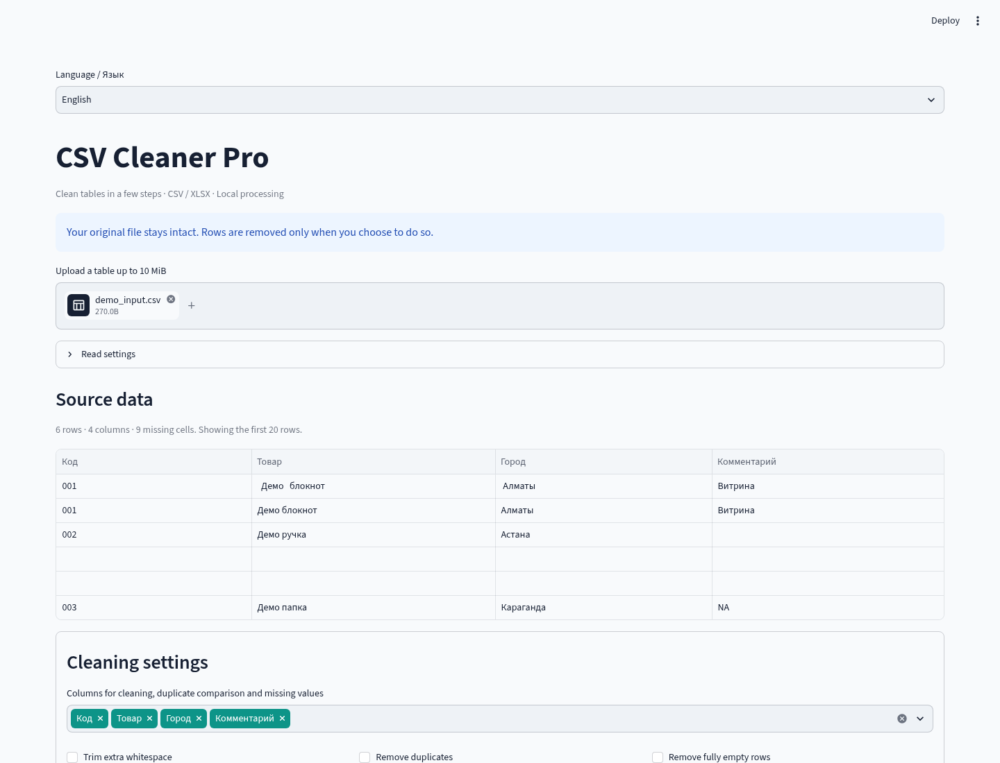
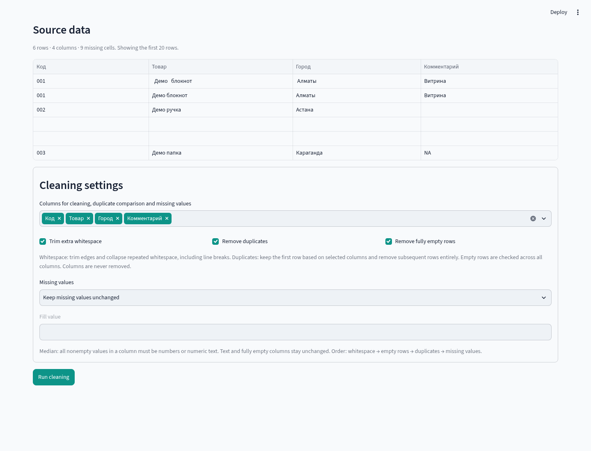
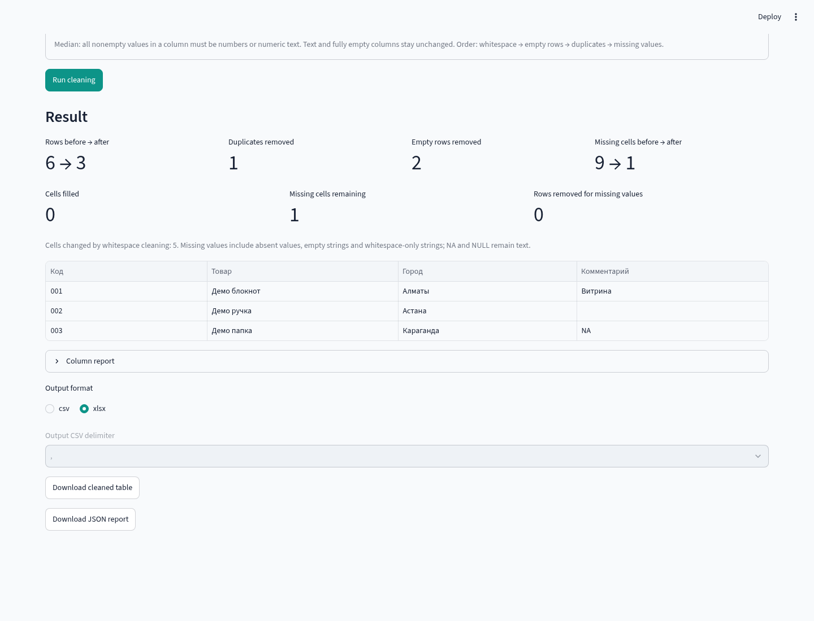

# CSV Cleaner Pro

Clean product lists, price tables and other CSV/XLSX files with rules you choose. Preview the data, remove duplicates and extra spaces, handle missing values, then download the result and a JSON report. Includes fictional sample data.

[Русская документация](README_RU.md) · [Technical reference](docs/TECHNICAL.md) · [Testing](TESTING.md)

## What it does

- English / Русский switch with English by default; keeps uploads, settings and results when switching.
- Opens CSV and XLSX and previews the first 20 rows.
- Counts missing cells, including empty strings and whitespace.
- Optionally trims whitespace, removes duplicate rows, and removes fully empty rows.
- Handles missing cells in selected columns: keep (default), drop affected rows, fill with a supplied value, or fill numeric columns with the median.
- Lets you choose columns for whitespace cleaning, duplicate comparison and missing-value handling.
- Reports rows before/after, duplicate and empty row removals, filled cells, remaining missing cells, rows removed for missing values, and missing cells per column.
- Downloads a new CSV (UTF-8 with BOM) or XLSX and a JSON report.

All cleaning switches start **off**. Your original file is never overwritten. The local Streamlit process handles all file processing.

## Run locally

Python **3.12+**. Download and extract the repository, or use your existing local checkout. Open a terminal in the repository root (the folder containing `app.py` and `requirements.txt`). On Linux/macOS with Bash or Zsh:

```bash
python -m venv .venv
source .venv/bin/activate
python -m pip install -r requirements.txt
python -m streamlit run app.py
```

Open **http://127.0.0.1:8501**. Stop with `Ctrl+C`. For Fish, use `source .venv/bin/activate.fish`. On Windows PowerShell, replace the activation command with `.venv\Scripts\Activate.ps1`; in cmd.exe use `.venv\Scripts\activate.bat`. A network connection is needed to install dependencies, but processing runs locally afterward.

## Try the demo

1. Upload `examples/demo_input.csv` or `examples/demo_input.xlsx`.
2. Keep all columns selected and enable all three cleaning switches.
3. Click **Run cleaning**.
4. Expect **6 → 3 rows**, **1 duplicate** and **2 empty rows** removed, **9 → 1 missing cells**, and **5 cells** changed by whitespace cleaning.
5. Download the result and compare it with `examples/demo_output.csv` and `examples/cleaning_report.json`.

The demo uses fictional product records. JSON reports use the same English field names in both interface languages.

## Screenshots: input → settings → result

Real Chromium screenshots using only `examples/demo_input.csv`:





[Reproduce these captures](docs/SCREENSHOTS_RU.md).

## Technologies and tests

Python 3.12+, Streamlit 1.67+, pandas, openpyxl, defusedxml and pytest.
Localization uses a small Python catalog without additional runtime dependencies.

The test suite covers both languages,
all four missing-value modes, language-switch data preservation, Arrow-safe previews,
and CSV/XLSX round trips. The real-browser check also verifies CSV, XLSX and JSON
downloads and switching to Russian with the uploaded file and result retained.
Playwright is optional and needed only to reproduce the browser check and screenshots.

## Documentation

- [Technical reference](docs/TECHNICAL.md): exact rules, limits, API examples, tests and project layout.
- [Russian technical reference](docs/TECHNICAL_RU.md).
- [Testing](TESTING.md): reproducible commands, coverage and tested versions.

Run checks from the repository root, with the virtual environment activated:

```bash
python -m pytest -W error -q
```

## Limitations

- CSV/XLSX only; one XLSX sheet per run. Workbook styles, charts and other sheets are not retained.
- Maximum upload: **10 MiB**; expanded XLSX: **50 MiB**; table: **100,000 rows**, **200 columns**, **1,000,000 cells**.
- Processing runs in memory on localhost. Public deployment requires additional access and resource controls.
- CSV delimiter detection can be ambiguous; check the preview or choose a delimiter manually.
- CSV preserves formula-like text; spreadsheet applications may interpret it as formulas. Import these cells as text or choose XLSX, which exports strings as text.
- Native Streamlit and browser controls may use their own language.

## License

MIT — see [LICENSE](LICENSE).
