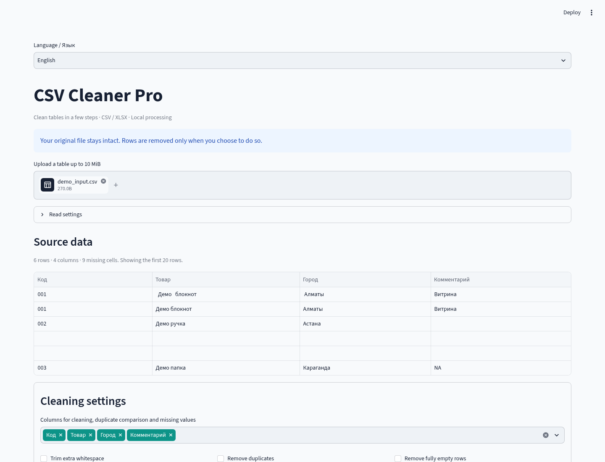
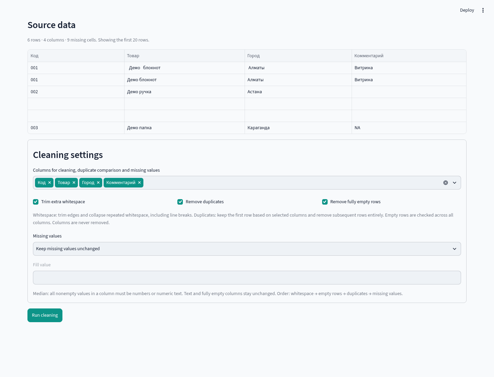
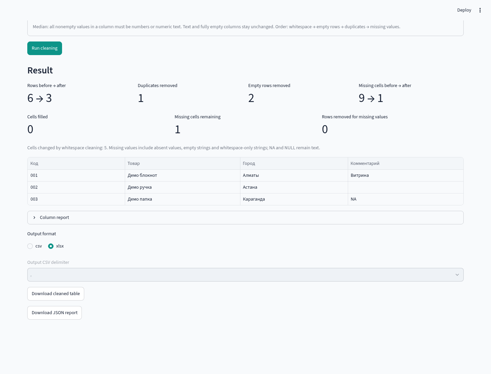

# CSV Cleaner Pro

Локальное приложение для очистки CSV и Excel. Загрузите таблицу, проверьте первые 20 строк, выберите правила и скачайте новый файл вместе с отчётом.

[English README](README.md) · [Техническая документация](docs/TECHNICAL_RU.md) · [Тестирование](TESTING.md)

## Локальный запуск

Нужен Python 3.12 или новее. Скачайте и распакуйте репозиторий либо используйте имеющуюся локальную копию. Откройте терминал в корне проекта — каталоге с `app.py` и `requirements.txt`. Для Linux/macOS с Bash или Zsh:

```bash
python -m venv .venv
source .venv/bin/activate
python -m pip install -r requirements.txt
python -m streamlit run app.py
```

Откройте http://127.0.0.1:8501. Для остановки нажмите `Ctrl+C`. Интернет требуется для первоначальной установки пакетов; обработка затем выполняется локально. В Fish замените команду активации на `source .venv/bin/activate.fish`. В Windows PowerShell используйте `.venv\Scripts\Activate.ps1`, в cmd.exe — `.venv\Scripts\activate.bat`.

## Возможности

- Переключатель English / Русский вверху: английский по умолчанию; файл, настройки и результат сохраняются при смене языка.
- CSV и XLSX, предпросмотр первых 20 строк.
- Поиск пустых значений, отчёт по каждому столбцу.
- Очистка лишних пробелов в выбранных столбцах.
- Удаление дубликатов по выбранным столбцам с сохранением первой строки.
- Опциональное удаление полностью пустых строк.
- Пропуски: оставить (по умолчанию), удалить строки, заполнить заданным значением или медианой.
- Статистика заполненных ячеек, оставшихся пропусков и удалённых строк с пропусками.
- Скачивание CSV, XLSX и JSON-отчёта.

Все переключатели очистки изначально выключены. Исходный файл не перезаписывается. Обработка работает с копией таблицы; столбцы не удаляются, пропуски не заполняются автоматически.

## Пример работы

Загрузите `examples/demo_input.csv` или `examples/demo_input.xlsx`. Оставьте все столбцы выбранными, включите три правила и запустите обработку.

Ожидаемый результат: 6 → 3 строки, удалён 1 дубликат и 2 пустые строки; пустых значений 9 → 1; пробелы изменены в 5 ячейках. Результаты для сравнения: `examples/demo_output.csv`, `examples/demo_output.xlsx`, `examples/cleaning_report.json`. Данные вымышленные.

## Скриншоты: исходные данные → настройки → результат

Три настоящих снимка английского интерфейса в Chromium, данные только из `examples/demo_input.csv`:





[Как повторить съёмку](docs/SCREENSHOTS_RU.md).

## Технологии и тесты

Python 3.12+, Streamlit 1.67+, pandas, openpyxl, defusedxml, pytest.
Переводы хранятся в небольшом Python-каталоге без дополнительных зависимостей.
Пользовательские данные и названия столбцов не переводятся. JSON-файл отчёта сохраняет
одинаковые английские технические ключи при любом языке интерфейса.

**155 тестов пройдено** с предупреждениями как ошибками: оба языка, четыре режима
пропусков, сохранение данных при смене языка, PyArrow и экспорт CSV/XLSX/JSON.
В настоящем Chromium также проверены скачивание трёх форматов и переключение на русский
без потери файла и результата. Playwright нужен только для повторной браузерной проверки.

## Документация и проверка

- [Техническая документация](docs/TECHNICAL_RU.md): правила, ограничения, примеры API, тесты и структура проекта.
- [English technical reference](docs/TECHNICAL.md).
- [Тестирование](TESTING.md): воспроизводимые команды, покрытие и версии окружения.

Из корня проекта с активированным окружением:

```bash
python -m pytest -W error -q
```

## Ограничения

- Только CSV/XLSX, один лист XLSX за запуск. Стили, диаграммы и другие листы книги не сохраняются.
- До **10 МиБ** на загрузку, **50 МиБ** распакованного XLSX, **100 000 строк**, **200 столбцов**, **1 000 000 ячеек**.
- Обработка выполняется в памяти на localhost. Для публичного сервера нужны дополнительные ограничения доступа и ресурсов.
- Автоопределение разделителя CSV может быть неоднозначным; доступен ручной выбор и предпросмотр.
- CSV сохраняет текст, похожий на формулы; табличный редактор может его выполнить как формулу. Импортируйте такие ячейки как текст или выберите XLSX, который записывает строки текстом.
- Встроенные элементы Streamlit и браузера могут использовать собственный язык.

## Лицензия

MIT — [LICENSE](LICENSE).
